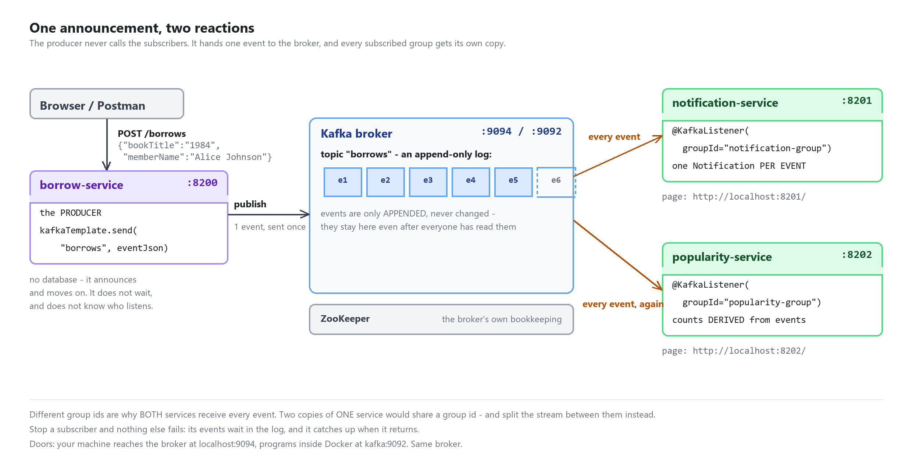

# sample-boot-pubsub — **SOLUTION**

The finished version of
[`sample-boot-pubsub`](https://github.com/cnacha-mfu/sample-boot-pubsub).

Every step in that repo's [TODO.md](https://github.com/cnacha-mfu/sample-boot-pubsub/blob/master/TODO.md)
links to the file here that answers it.

---

## What is different from the starting point

Three files. Everything else — the entities, the repositories, the pages, the
tests, the Postman collection, the compose file — is identical, so the two
repos can be compared directly:

```bash
diff -r --exclude=.git --exclude=target --exclude=README.md --exclude=TODO.md \
        --exclude=.github \
  sample-boot-pubsub sample-boot-pubsub-solution
```

| File | Answers |
| --- | --- |
| `library-borrow-service/.../BorrowController.java` | step 1 — publish |
| `library-notification-service/.../BorrowPlacedListener.java` | step 2 — subscribe and store |
| `library-popularity-service/.../BorrowPlacedListener.java` | step 3 — subscribe and derive |

Steps 4 and 5 have no code — they are demonstrations, scripted in TODO.md.

Each file has comments explaining **why** the code is what it is — they are
meant to be read out during the session.

## Running the tests

```bash
mvn test          # 12 tests, all green - no broker needed
```

```
Tests run: 4, Failures: 0, Errors: 0 - in th.mfu.borrow.BorrowServiceTests
Tests run: 4, Failures: 0, Errors: 0 - in th.mfu.notification.NotificationServiceTests
Tests run: 4, Failures: 0, Errors: 0 - in th.mfu.popularity.PopularityServiceTests
BUILD SUCCESS
```

The tests never touch a broker: the producer's `KafkaTemplate` is mocked, and
the listeners are called directly with the record the broker would have
delivered. Tested with Maven 3.9 on JDK 11 and JDK 18.

## Running the whole thing

```bash
docker compose up                                        # ZooKeeper + Kafka
mvn install -DskipTests
mvn -pl library-borrow-service        spring-boot:run    # 8200
mvn -pl library-notification-service  spring-boot:run    # 8201
mvn -pl library-popularity-service    spring-boot:run    # 8202
```

Pages: <http://localhost:8201/> and <http://localhost:8202/>. Watch the raw
events with:

```bash
docker exec -it kafka kafka-console-consumer \
  --bootstrap-server localhost:9092 --topic borrows --from-beginning
```

## How it fits together



The diagram is made by `docs/make_pubsub_diagram.py`. Change that script if you
change the sample, then run `python docs/make_pubsub_diagram.py .` and copy the
PNG to the student repository. You need Python with Pillow
(`pip install pillow`).

## The answer, in short

```java
// BorrowController - the producer. One line, no waiting, no knowledge of readers
kafkaTemplate.send(topicName, borrowJson);

// notification listener - subscribe, parse, react
@KafkaListener(topics = "${app.kafka.topic:borrows}", groupId = "notification-group")
public void onBorrowPlaced(ConsumerRecord<String, String> record) throws Exception {
    JsonNode event = objectMapper.readTree(record.value());
    ...
    notificationRepository.save(new Notification(memberName, bookTitle, message));
}

// popularity listener - same event, DIFFERENT group id, different reaction
@KafkaListener(topics = "${app.kafka.topic:borrows}", groupId = "popularity-group")
...
entry.setBorrowCount(entry.getBorrowCount() + 1);
```

## Points to make during the session (mapped to the lecture slides)

1. **`send()` is not a call.** Put the microservice sample's Feign line on the
   screen next to it. The Feign call needed the other service up, fast, and
   correct — remember the two catch blocks and the timeout. `send()` needs none
   of that, because it talks to the broker, not to the subscribers. *(slides:
   event-driven architecture, components communicate by producing and reacting
   to events)*

2. **The console consumer is the broker made visible.** Students believe in the
   broker when they see an event lying in the topic before any subscriber
   exists. Keep that window open all session. *(slides: message broker; topics)*

3. **The group id is the whole pub/sub story.** Different groups → every group
   gets every event (our two services). Same group → the members share the
   stream (that is what two *copies* of one service would do — and that is
   Kafka doing the load balancing they met last week, for free). One string,
   both behaviours. *(slides: publishers, subscribers, broker)*

4. **Step 4 is the payoff — do not rush it.** Stop the notification service,
   keep posting, restart, watch it catch up. Last week a stopped service meant
   503s; this week it means "later". That contrast is the honest definition of
   decoupling. *(slides: components are decoupled; scalability, flexibility,
   responsiveness)*

5. **Step 5 is event sourcing without saying so first.** Do the replay, watch
   the counts rebuild, and *then* put the name on it: the topic is an
   append-only log, the events are the truth, the table is a disposable
   summary. Immutability follows: change an event and every rebuilt summary
   would disagree with the past. *(slides: event sourcing, event store, state
   derived by applying events; benefits — audit trail, temporal queries)*

6. **Why is there no Eureka today?** Nobody calls anybody, so nobody needs to
   find anybody. The broker is the only address in the system. Worth asking as
   a question — it checks they understood *why* Eureka existed last week.

7. **ZooKeeper, in one breath.** It is the broker's own bookkeeping, students
   never touch it, and Kafka 4.0 replaced it with KRaft. One sentence, move on.
   *(slides: ZooKeeper; the KRaft update slide)*

8. **The challenges slide is real — point at where it bit.** Complexity: five
   terminals for "hello borrow". Querying: the popularity service exists only
   because you cannot ask a log a question — you derive a table first. Event
   evolution: what happens to old events if next month the payload needs a
   `memberId`? (They stay as they are — you handle both shapes. Events are
   never edited.) *(slide: challenges)*

## Mistakes students often make

| What they do | What happens |
| --- | --- |
| Reuse `notification-group` in the popularity listener | The two services silently SHARE the stream: each event reaches only one of them, pages update alternately |
| Point a local service at `kafka:9092` | `Connection to node -1 could not be established` — that is the Docker-side door; from the host it is `localhost:9094` |
| Start the services before the broker | Connection errors in the log until Kafka is healthy; they stop by themselves |
| Expect the 201 to prove a subscriber ran | It only proves the broker accepted the event. Stop both subscribers and it is still 201 |
| Replay into a table that already has counts | Numbers double. Restart the service first — fresh in-memory DB — then replay with a new group |
| Edit `auto-offset-reset` to `latest` | A new group starts "from now" and the replay demo shows nothing |
| Run the lab's compose at the same time | Ports 2181/9092/9094 clash. `docker compose down` one stack first |
| Edit the test files | The tests are the specification |

## The bridge to lab-web-pubsub

The lab is this sample with a different story: `POST /orders` publishes an
"order placed" event; `payment-service` and `shipping-service` subscribe with
their own groups and persist what they hear. Two changes of scenery to warn
them about: everything runs **inside Docker** there (broker address
`kafka:9092`), and the lab parses the JSON with a provided helper method
instead of Jackson — either way works.
